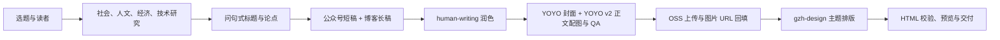

# YOYO GZH Workflow

将一个中文选题整理成「公众号 + 博客」双渠道内容包，完成研究、问句式选题、human-writing 润色、YOYO 封面和正文配图、Aliyun OSS 上传，以及可粘贴到微信公众号编辑器的 HTML 排版。

主工作流及其写作、配图依赖同步自本地最新 Skill。完整编排规则见 [yoyo-gzh](skills/yoyo-gzh/SKILL.md)。

## 本次版本更新

- 使用 [human-writing](skills/human-writing/SKILL.md) 替代旧版 khazix-writer，增加事实材料检查和成稿自检。
- 增加 [YOYO 封面规范](skills/yoyo-gzh/references/yoyo-cover.md)，默认 5:2，标题在左、YOYO 在右，角色宽度约占画布的 25%–30%，动作紧扣文章主题。
- 正文配图升级为 [YOYO v2](skills/yoyo-illustrations/SKILL.md)，使用内置 imagegen，支持可选的 001–279 编号画风与 safe、balanced、full 融合强度。
- Markdown 图片 alt 保留可访问性描述；YOYO 正文配图在公众号 HTML 中不显示额外图注。
- 移除旧 Google API 生图脚本和相关配置，增加 Skill 的 agents/openai.yaml 元数据。

## 标准交付物

| 文件 | 用途 |
| --- | --- |
| `outputs/<slug>-wechat.md` | 约 1,500 字的公众号 Markdown |
| `outputs/<slug>-blog.md` | 更完整的博客长文，包含证据、权衡与参考资料 |
| `outputs/<slug>-cover-brief.md` | 封面创意简报及上传后的 OSS URL |
| `assets/<slug>-cover.png` | 包含最终文章原题的 YOYO 封面 |
| `assets/<slug>-illustrations/` | 两个版本共用的 16:9 正文配图 |
| `outputs/<slug>-wechat_排版_<theme>.html` | 可复制到公众号的 HTML 片段 |
| `outputs/<slug>-wechat_排版_<theme>_预览.html` | 带「复制到公众号」按钮的预览页 |

公众号通常使用 2–4 张正文配图，博客使用 3–6 张；共用图片只生成一次。用户不需要封面时可以跳过封面步骤。详细交付规则见 [output-contract.md](skills/yoyo-gzh/references/output-contract.md)。

## 流程概览



## 运行环境与依赖

本仓库是供 Codex 执行的 Skill 工作流包，需要支持内置 imagegen 的环境。它不提供一个独立运行全部步骤的 Python 命令。

仓库内包含 yoyo-gzh、human-writing、yoyo-illustrations、aliyun-oss-upload 和 gzh-design。把需要使用的目录安装到当前环境的技能目录，或让执行环境从本仓库加载它们。

- **imagegen** 使用 Codex 自带的 Skill 与能力，封面和正文配图均不需要 Google API Key。能力不可用时报告生成受阻，不自动切换 API 或 CLI。
- **handdraw-style-prompter** 是可选外部依赖，本仓库未打包其编号画风资产库。选择 001–279 画风或 SC-008 一类布局时，需完整安装该包；原生 YOYO 模式不需要它。解析规则见 [handdraw-integration.md](skills/yoyo-illustrations/references/handdraw-integration.md)。
- **Aliyun OSS** 仅在上传图片时需要凭据，使用本仓库保留的环境变量配置方式。

## 快速开始

```bash
git clone https://github.com/jackyoung022/yoyo-gzh-workflow.git
cd yoyo-gzh-workflow
python3 -m pip install -r requirements.txt
cp .env.example .env
```

填写 `.env` 中的 OSS 配置后导入当前 shell：

```bash
set -a
source .env
set +a
```

| 变量 | 用途 |
| --- | --- |
| `ALIYUN_OSS_REGION` | OSS 区域，例如 oss-cn-hangzhou |
| `ALIYUN_OSS_BUCKET` | 提供公开图片访问的 Bucket |
| `ALIYUN_ACCESS_KEY_ID` | 上传凭据 ID |
| `ALIYUN_ACCESS_KEY_SECRET` | 上传凭据 Secret |

也可以从 `skills/aliyun-oss-upload/config.example.json` 创建本机私有 `config.json`；环境变量优先。真实配置文件已被 Git 忽略。凭据缺失时保留本地图片并报告上传受阻。

加载 Skill 后，可以使用这样的请求：

```text
用 $yoyo-gzh 把这个选题制作成公众号和博客内容包，生成 YOYO 封面和正文配图，并输出可复制的公众号 HTML。
```

可选要求包括主题、封面比例、正文画风编号、融合强度及布局编号。

## 上传与排版命令

在成稿、图片生成与 QA 完成后，上传每张封面和正文图：

```bash
python3 skills/aliyun-oss-upload/scripts/oss_upload.py \
  assets/example-cover.png articles/example/cover.png
python3 skills/aliyun-oss-upload/scripts/oss_upload.py \
  assets/example-illustrations/01-core-question.png \
  articles/example/01-core-question.png
```

封面 URL 写入简报，正文图片 URL 写入两篇 Markdown。封面默认不作为第一张正文图插入。

按 [gzh-design](skills/gzh-design/SKILL.md) 读取主题与通用组件，再生成 HTML 片段。YOYO 正文图的 alt 仅用作可访问性描述，省略组件中的可见说明段落。主流程默认科技评论用石墨极简风，深度分析用红白色系，实用清单用摸鱼绿；用户指定主题时优先使用。

```bash
python3 skills/gzh-design/scripts/validate_gzh_html.py \
  'outputs/example-wechat_排版_石墨极简风(graphite-minimal).html'
python3 skills/gzh-design/scripts/wrap_preview.py \
  'outputs/example-wechat_排版_石墨极简风(graphite-minimal).html'
```

HTML 校验需达到 0 ERROR，正文中有影响的半角标点警告也要修复。打开预览页，点「复制到公众号」，再粘贴到公众号编辑器。

## 仓库检查

```bash
python3 scripts/check_repository_safety.py
git diff --check
git status --ignored
```

不要提交真实凭据、本机私有配置、`.DS_Store` 或生成的文章与图片。许可与来源说明见 [LICENSE](LICENSE) 和 [THIRD_PARTY_NOTICES.md](THIRD_PARTY_NOTICES.md)。
