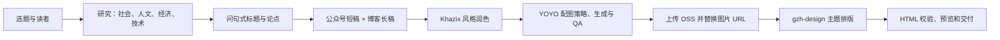

# YOYO GZH Publisher

将一个中文选题整理为可发布的「公众号 + 博客」双渠道内容包：研究与跨学科分析、问句式选题、卡兹克式润色、YOYO 正文配图、Aliyun OSS 图床，以及可粘贴到微信公众号编辑器的 HTML 排版。

本仓库是可独立归档和二次开发的工作流包，不包含任何真实 API Key、AccessKey 或个人配置。

## 能产出什么

每个选题的标准交付物如下：

- `outputs/<slug>-wechat.md`，约 1,500 字的公众号 Markdown
- `outputs/<slug>-blog.md`，含证据、权衡和参考资料的长文 Markdown
- `assets/<slug>-illustrations/`，2–6 张 16:9 YOYO 正文配图
- `outputs/<slug>-wechat_排版_<theme>.html`，可直接粘贴到公众号的 HTML 片段
- `outputs/<slug>-wechat_排版_<theme>_预览.html`，带「复制到公众号」按钮的预览页

## 流程概览



完整编排规则见 [主工作流](skills/yoyo-gzh/SKILL.md)。每一个配套模块都保留在 `skills/` 下，便于作为 Codex skill 使用或按步骤手工执行。

## 快速开始

```bash
git clone https://github.com/<your-account>/yoyo-gzh-publisher.git
cd yoyo-gzh-publisher
python3 -m pip install -r requirements.txt
cp .env.example .env
set -a; source .env; set +a
```

将 `.env` 中的占位符替换为你自己的凭证，然后再执行一次 `set -a; source .env; set +a`，将变量导入当前 shell。不要把 `.env` 提交到 Git。若用 `direnv`、Docker Secrets 或 CI 的 Secrets 管理功能，也可以不创建 `.env`，直接注入下述环境变量。

### 必需配置

| 用途 | 变量 | 何时需要 |
| --- | --- | --- |
| YOYO 生图 | `GOOGLE_API_KEY` | 调用 `generate_image.py` 时 |
| OSS 区域 | `ALIYUN_OSS_REGION` | 上传图片时 |
| OSS Bucket | `ALIYUN_OSS_BUCKET` | 上传图片时 |
| OSS AccessKey ID | `ALIYUN_ACCESS_KEY_ID` | 上传图片时 |
| OSS AccessKey Secret | `ALIYUN_ACCESS_KEY_SECRET` | 上传图片时 |

示例仅展示变量名，不展示任何可用密钥：

```bash
export GOOGLE_API_KEY="replace-with-your-google-api-key"
export ALIYUN_OSS_REGION="oss-cn-hangzhou"
export ALIYUN_OSS_BUCKET="your-public-bucket"
export ALIYUN_ACCESS_KEY_ID="replace-with-your-access-key-id"
export ALIYUN_ACCESS_KEY_SECRET="replace-with-your-access-key-secret"
```

OSS 上传还支持本机私有文件 `skills/aliyun-oss-upload/config.json`。先从 `config.example.json` 复制，文件已被 `.gitignore` 排除。环境变量优先于该文件。

## 一次完整生产的执行顺序

1. 在 `assets/<slug>-illustrations/` 规划并生成 2–6 张配图。生成说明和提示词模板见 [YOYO 配图技能](skills/yoyo-illustrations/SKILL.md)。
2. 对每张通过 QA 的图片执行上传，捕获打印出的公开 URL：

   ```bash
   python3 skills/aliyun-oss-upload/scripts/oss_upload.py \
     assets/<slug>-illustrations/01-core-question.png \
     articles/<slug>/01-core-question.png
   ```

3. 将两个 Markdown 草稿中的本地图片路径都替换为 OSS URL。
4. 按 [gzh-design](skills/gzh-design/SKILL.md) 选择主题，阅读主题组件库与通用组件库后生成纯 `<section>` HTML。
5. 对 HTML 执行强制校验，再生成预览页面：

   ```bash
   python3 skills/gzh-design/scripts/validate_gzh_html.py outputs/<slug>-wechat_排版_石墨极简风(graphite-minimal).html
   python3 skills/gzh-design/scripts/wrap_preview.py outputs/<slug>-wechat_排版_石墨极简风(graphite-minimal).html
   ```

6. 运行仓库安全检查后再提交：

   ```bash
   python3 scripts/check_repository_safety.py
   git add .
   git status
   git commit -m "Initial public workflow package"
   ```

## 目录说明

```text
skills/
  yoyo-gzh/              # 总编排与交付契约
  khazix-writer/         # 写作语气与四层自检
  yoyo-illustrations/    # YOYO 资产、提示词、QA、生成脚本
  aliyun-oss-upload/     # 使用环境变量的 OSS 上传脚本
  gzh-design/            # 主题组件、HTML 校验与预览脚本
scripts/check_repository_safety.py
.env.example             # 只含变量名和占位符
```

## 发布前安全清单

- 运行 `python3 scripts/check_repository_safety.py`，确保通过。
- 检查 `git status --ignored`，确认 `.env` 与 `skills/aliyun-oss-upload/config.json` 没有被暂存。
- 在 GitHub 仓库设置中打开 Secret scanning 与 Push protection。
- 若一个凭证曾被提交、推送或贴进公开讨论，即刻在对应平台撤销并重新生成，删文件或改 Git 历史都不能代替轮换。
- 用最小权限的 OSS RAM/STS 凭证，并限制可写 Bucket 和前缀。

## 许可与归属

`gzh-design` 组件库以 AGPL-3.0-or-later 许可提供，因此本仓库应以兼容的 AGPL-3.0-or-later 方式发布；完整文本见 [LICENSE](LICENSE)。其余上游来源、YOYO 角色资产和卡兹克写作规范的归属与发布前检查见 [THIRD_PARTY_NOTICES.md](THIRD_PARTY_NOTICES.md)。
